# Чат: шлюз и три службы

Я собирал учебный чат, в котором два человека пишут друг другу из разных окон. Снаружи одна страница, `http://127.0.0.1:5090`. Внутри четыре процесса: шлюз только разводит запросы, а учётные записи, комнаты и сообщения живут отдельно и у каждого своя база.

Сначала на странице регистрация и вход. После входа та же страница меняется: остаются имя, аватар и список чатов. Сам разговор открывается отдельным окном и не закрывает профиль. Второго человека я пускаю не копией вкладки, а кнопкой «Окно для другого человека»: у копии вкладки был бы тот же вход.

## Как это устроено

Браузер ходит только в шлюз. Шлюз спрашивает Account, Room и Message. Своей базы у шлюза нет. Message не лезет в базу пользователей напрямую: имя и аватар для истории он получает через шлюз.

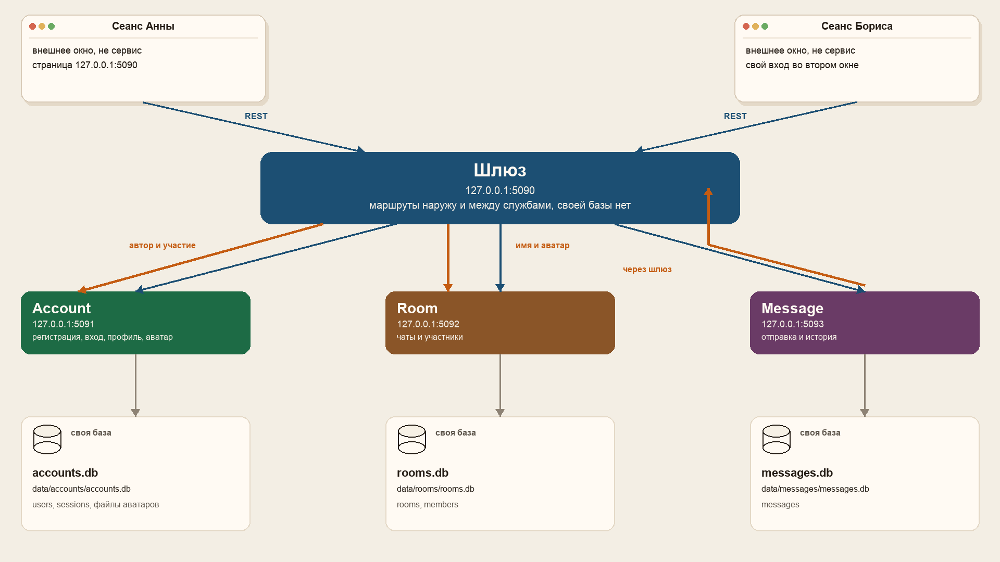

| Процесс | Порт | Что делает | База |
|---|---|---|---|
| Gateway | 5090 | страница и маршруты наружу | нет |
| Account | 5091 | регистрация, вход, имя, аватар | `data/accounts/accounts.db` |
| Room | 5092 | чаты и участники | `data/rooms/rooms.db` |
| Message | 5093 | отправка и история | `data/messages/messages.db` |

Пароль в базу я не кладу открытым текстом: Account хранит хеш и соль. Сеанс держится в `sessionStorage` одного окна, поэтому второе окно начинает с чистого входа.

## Как запустить

Нужен .NET SDK 8.

Из корня проекта:

```bash
./scripts/run-services.sh
```

Страница: http://127.0.0.1:5090

Ctrl+C останавливает все четыре процесса. Папки `bin/`, `obj/` и `data/` в репозиторий не входят: базы и аватары появляются уже после запуска.

Проверка без браузера:

```bash
dotnet test tests/Chat.Tests/Chat.Tests.csproj -c Release
```

Там регистрация и вход, аватар только у Account, чужой человек не пишет в чат, пока не вступит, и у трёх служб разные файлы баз.

## Как я проверял двух людей

Я снял кадры по шагам. Почты вымышленные.

Пока человек не вошёл, на странице только регистрация и вход. Кнопки серые, пока поля пустые или почта не похожа на `имя@домен.зона`.

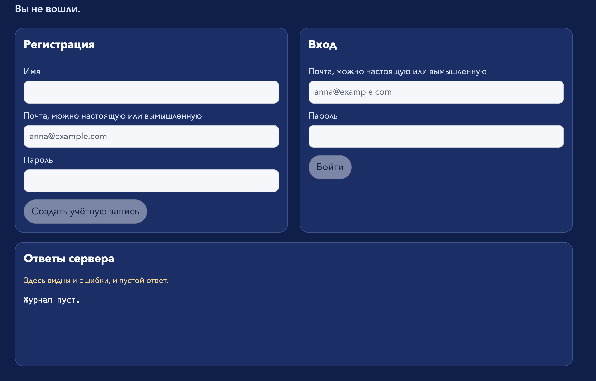

Для Emma я заполнил вход. Кнопка «Войти» стала белой только когда почта и пароль на месте.

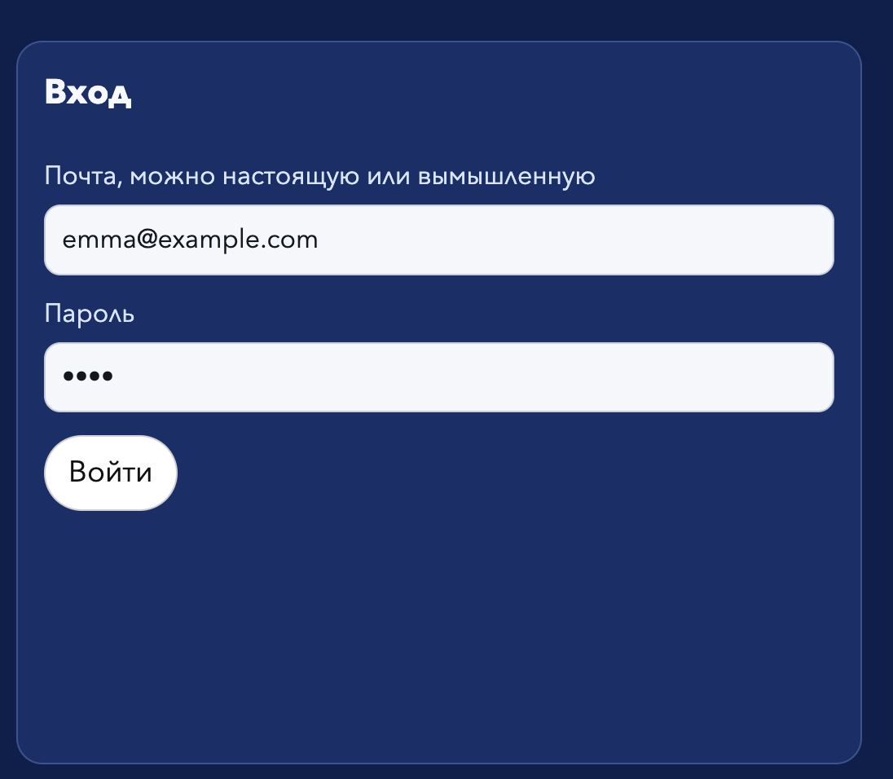

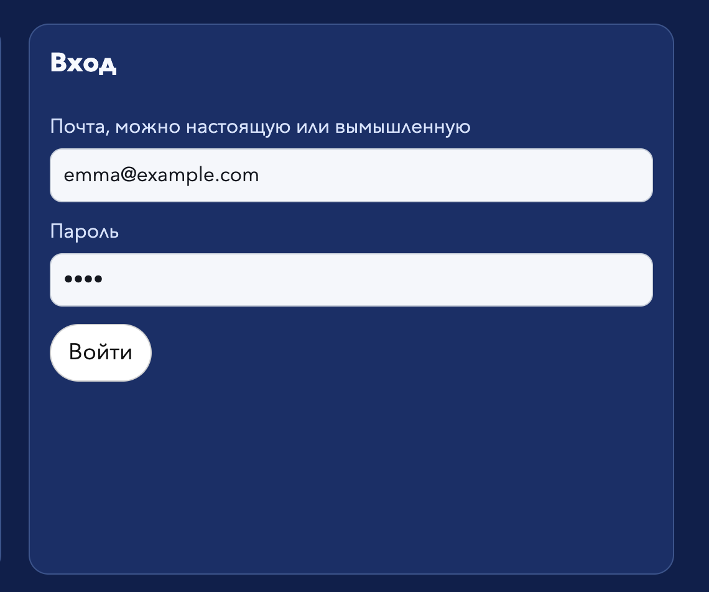

После регистрации под формой появилась надпись «Учётная запись создана».

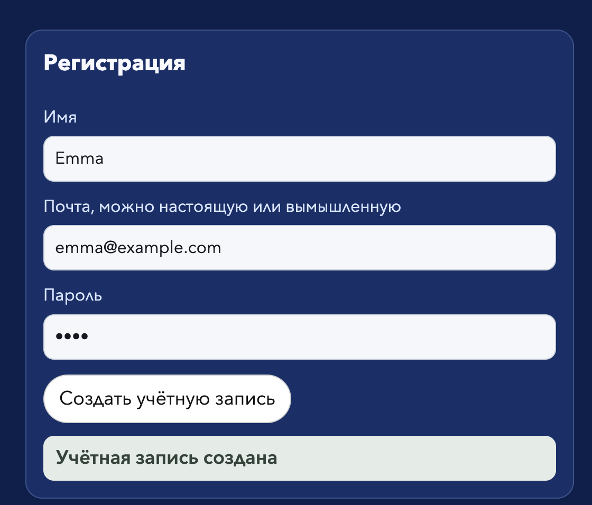

После входа страница не ушла на новый адрес. Сверху написано, под кем я вошёл: Emma (`emma@example.com`).


Текст на странице после входа другой: здесь уже профиль, а не форма регистрации.


Дальше профиль. «Сохранить имя» и «Загрузить аватар» зелёные, «Выйти» белая. Пока файл не выбран, загрузить аватар нельзя.

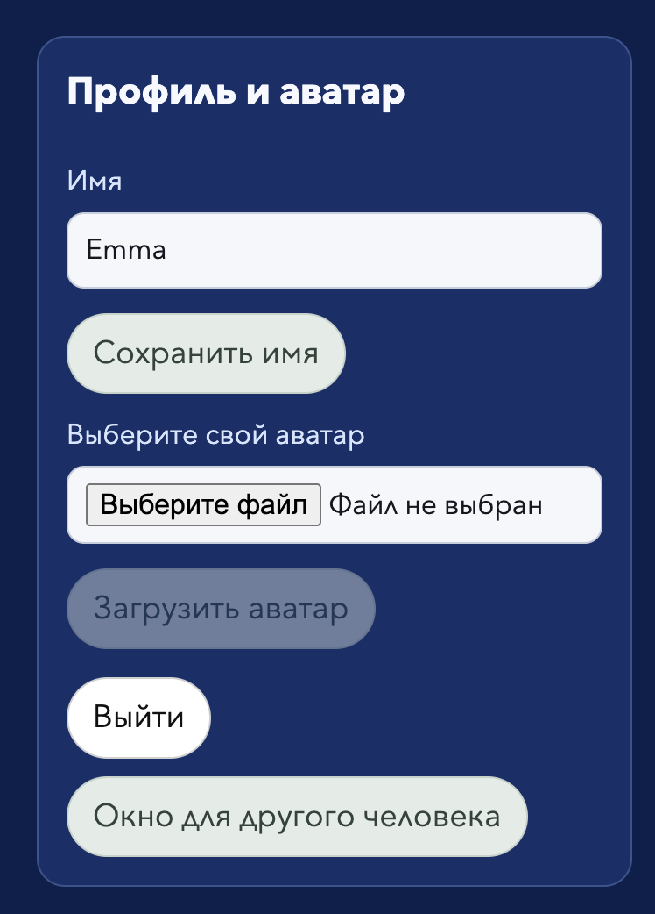

Файл выбрал, кнопка стала активной, аватар показался под формой.

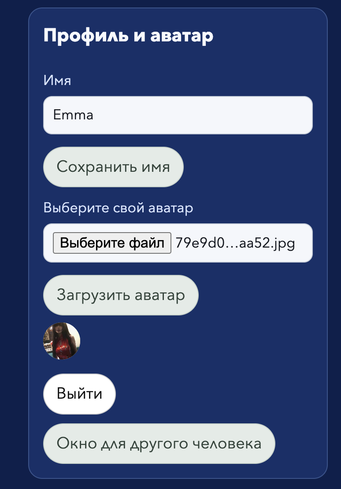

Чат «Test» открылся отдельным окном. Фон спокойный серо-зелёный, страница входа при этом остаётся. В участниках пока одна Emma.

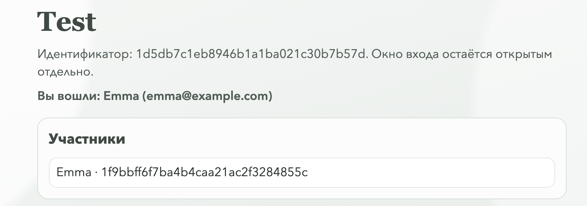

Второе окно я открыл кнопкой «Окно для другого человека». Там снова «Вы не вошли» и пустые формы. Это не копия первого сеанса.

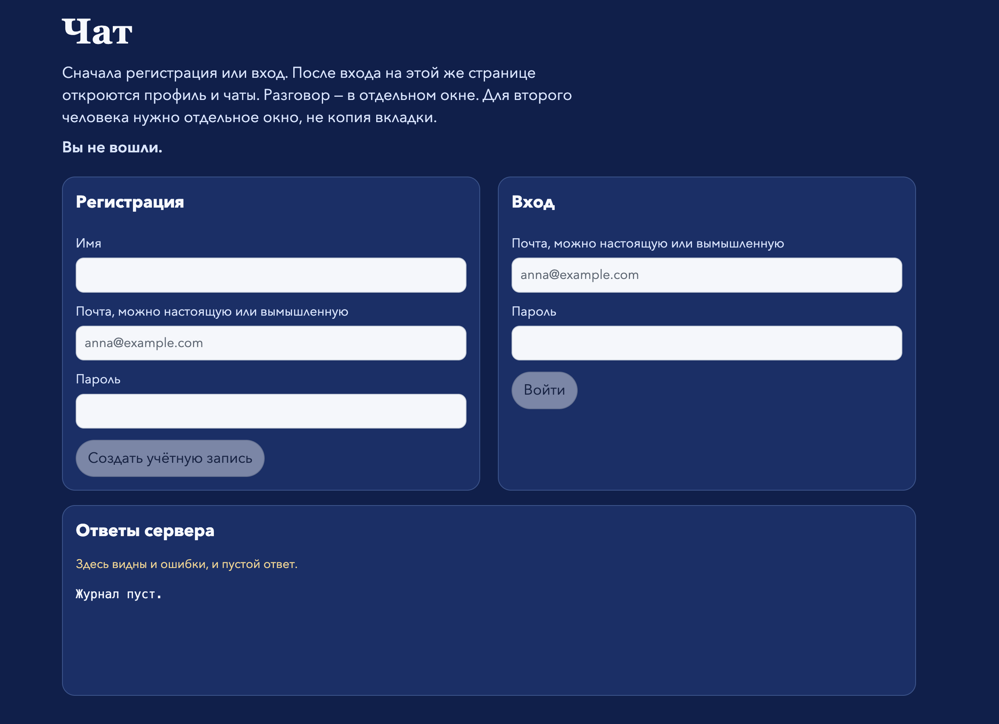

Во втором окне завёл Lara.

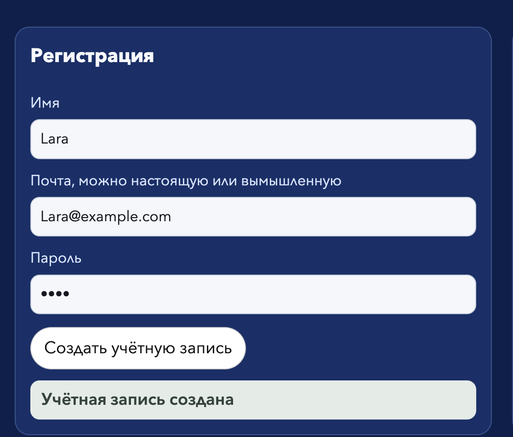

После входа Lara видит свой профиль и пустой список чатов. Создать чат и вступить нельзя, пока поля пустые.

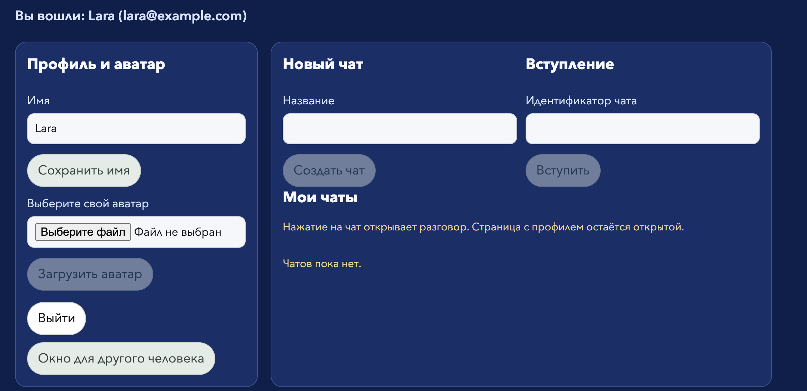

В журнале шлюз отдал `GET /api/me` с именем Lara и пустым аватаром.


Потом Lara тоже выбрала файл, и кнопка загрузки стала активной.

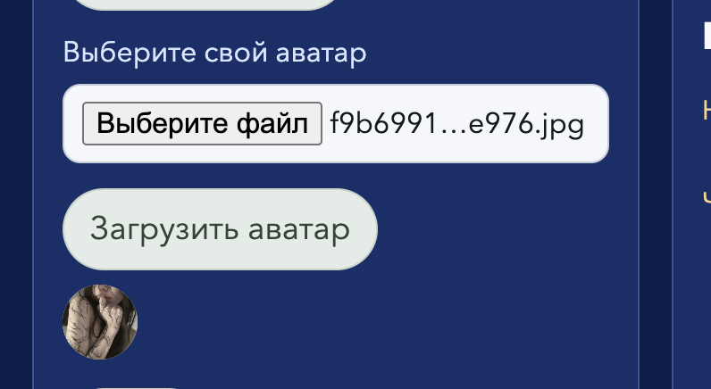

После загрузки в журнале `POST /api/me/avatar` ответил 200, и в профиле появился `avatarUrl`. Файл лежит у Account, не у шлюза.

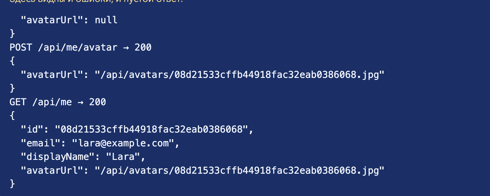

Lara вставила идентификатор чата Emma и нажала «Вступить».

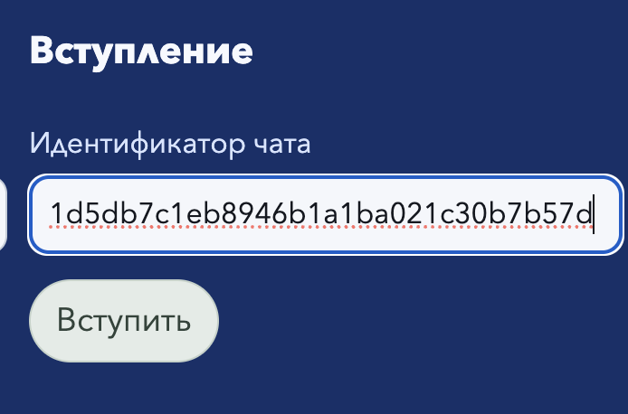

В окне чата Lara уже двое: Emma и Lara.

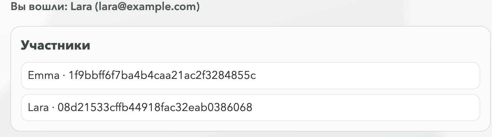

Emma написала «Hey Lara». В истории видно её имя и аватар.

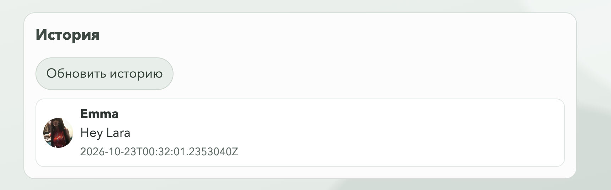

Lara ответила. Оба сообщения в одной истории, у каждого свой аватар.

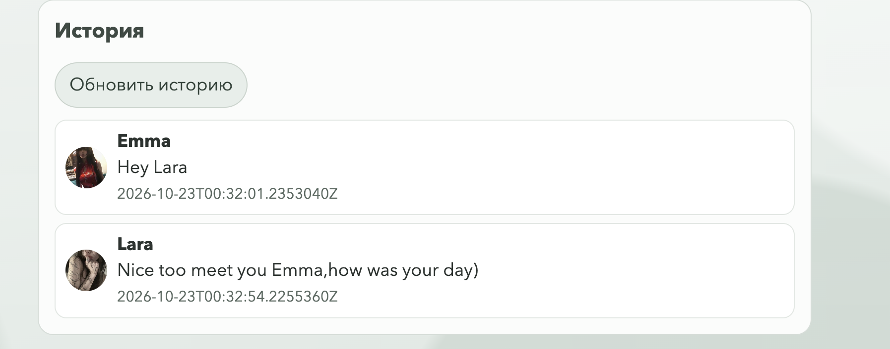

По «Обновить историю» на секунду появляется «История обновлена», потом надпись сама уходит. На кадре она ещё видна.

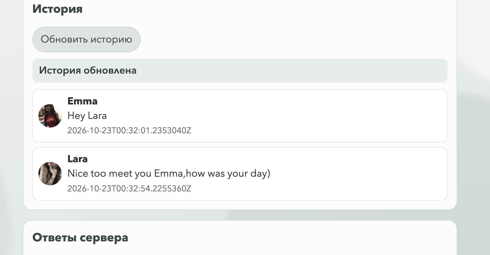

На странице профиля чат остаётся в списке: название, идентификатор и число участников. Нажатие снова открывает разговор и не закрывает профиль.

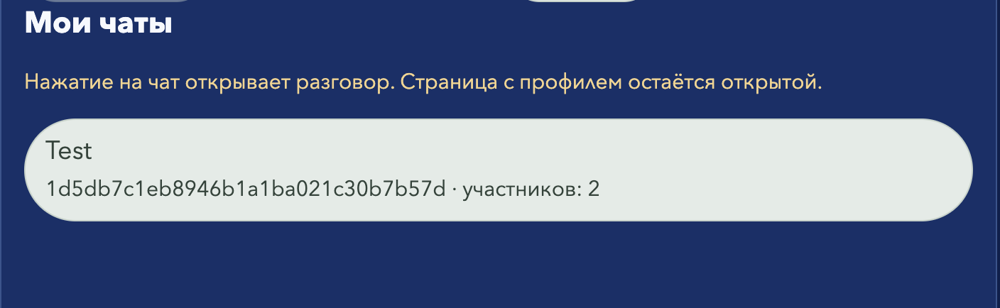

Сменить человека в том же окне можно кнопкой «Выйти»: снова показываются регистрация и вход.
